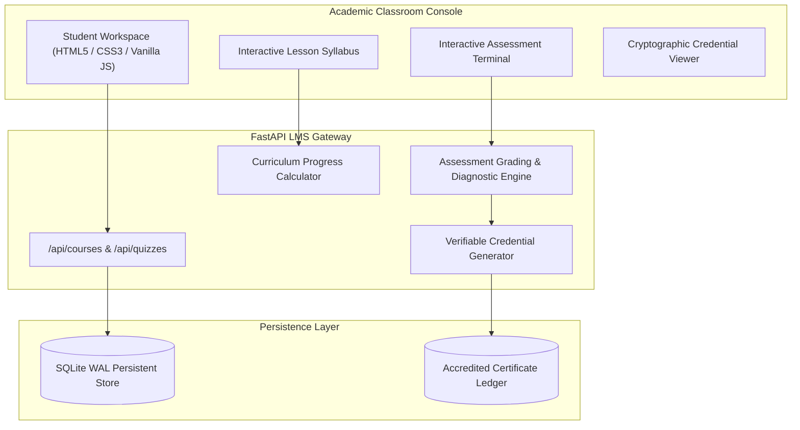

# LearnSphere

[](https://github.com/Soulofghost/learnsphere/actions/workflows/ci.yml)
[](LICENSE)
[](https://www.python.org/downloads/)
[](https://fastapi.tiangolo.com)
[]()

> **LearnSphere** is an enterprise-grade Online Learning Management System (LMS) and accreditation platform. It provides interactive curriculum syllabus tracking, automated multiple-choice assessment grading with pedagogical explanations, and cryptographic verifiable credential issuance.

---

## 🏛️ System Architecture



---

## ⚡ Core Engineering Capabilities

1. **Automated Assessment & Grading Engine (`quiz_grading.py`)**
   - Evaluates multi-question student submissions against question bank answer keys.
   - Computes score percentage:
     $$\text{Score \%} = \left(\frac{\text{Correct Questions}}{\text{Total Questions}}\right) \times 100$$
   - Enforces configurable passing thresholds (e.g. 75% or 80%) with diagnostic question feedback and theoretical explanations.

2. **Curriculum Progress Tracking**
   - Real-time syllabus completion calculation based on sequential module mastery:
     $$\text{Progress \%} = \min\left(100.0, \frac{|\text{Completed Modules}|}{|\text{Total Modules}|} \times 100\right)$$
   - Assessment Lockout Gate: Final certification exams remain locked until 100% of coursework modules are confirmed complete.

3. **Verifiable Cryptographic Credentials**
   - Generates unique cryptographic certificate identifiers (`CERT-LS-<HASH>`).
   - Public verification endpoint allows recruiters or third-party institutions to validate credential authenticity, recipient identity, syllabus title, and assessment score.

---

## 🔌 API Reference

| Method | Endpoint | Description |
|---|---|---|
| `GET` | `/api/health` | Health status and LMS engine version |
| `GET` | `/api/courses` | List course catalog (filter by discipline, difficulty level) |
| `GET` | `/api/courses/{slug}` | Full course syllabus, lessons, and enrollment state |
| `POST` | `/api/courses/{id}/enroll` | Enroll student in course |
| `POST` | `/api/courses/{id}/modules/{mod_id}/complete` | Mark syllabus lesson complete & update progress |
| `GET` | `/api/courses/{id}/quiz` | Fetch final assessment question sheet |
| `POST` | `/api/courses/{id}/quiz/submit` | Grade assessment & issue cryptographic certificate |
| `GET` | `/api/certificates/{code}/verify` | Public verification lookup for certificate code |
| `GET` | `/api/users/{email}/profile` | Student transcript (enrolled courses & certificates) |

---

## 🚀 Getting Started

### Local Development

1. **Clone repository:**
   ```bash
   git clone https://github.com/Soulofghost/learnsphere.git
   cd learnsphere
   ```

2. **Install dependencies:**
   ```bash
   pip install -r backend/requirements.txt
   ```

3. **Run tests:**
   ```bash
   pytest backend/tests -v
   ```

4. **Start the application:**
   ```bash
   uvicorn backend.app.main:app --reload --port 8000
   ```
   Open `http://localhost:8000` to access the Academic Classroom Console.

---

### Docker Deployment

```bash
docker-compose up --build -d
```

---

## 👨‍💻 Author

**Alvin MS**  
GitHub: [@Soulofghost](https://github.com/Soulofghost)
